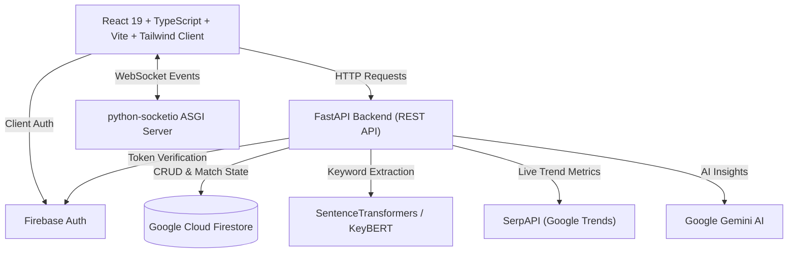

# Trend99 📈⚔️

**Trend99** is a real-time trend analytics intelligence engine and multiplayer trend-chaining duel platform. It integrates natural language processing (NLP), Google Trends metrics, and generative AI to evaluate topic popularity and power competitive multiplayer word-association duels.

---

## 🌟 Key Features

1. **AI Trend Analyzer**
   - Extract dominant keywords from arbitrary text using **KeyBERT** and **SentenceTransformers** (`all-MiniLM-L6-v2`).
   - Query Google Trends telemetry via **SerpAPI** for interest-over-time metrics.
   - Aggregate non-linear trend popularity scores with custom weighting algorithms.
   - Generate contextual insights and strategic topic recommendations with **Google Gemini 2.5 Pro**.

2. **Multiplayer Trend Duel (Real-Time Game)**
   - WebSocket / Socket.IO matchmaking lobby and queue system.
   - Head-to-head rounds where players submit keywords within specified genres/topics.
   - Live trend score calculation, real-time timer countdowns, and turn evaluation.
   - Match results, scoring breakdowns, and persistence in **Google Cloud Firestore**.

3. **Authentication & User Profiles**
   - Firebase Authentication supporting email/password and OAuth providers.
   - JWT validation middleware on the FastAPI backend using Firebase Admin SDK.
   - Redux Toolkit state persistence for seamless client-side user sessions.

4. **Analytics Dashboard**
   - User statistics, past duel records, and recent trend evaluations.

---

## 🏗️ System Architecture



---

## 💻 Tech Stack

### Frontend (`client/`)
- **Runtime & Bundler:** Vite 6, Node.js (ESNext / TypeScript)
- **Framework:** React 19, React Router DOM v7
- **State Management:** Redux Toolkit (`@reduxjs/toolkit`, `react-redux`)
- **Styling & UI:** Tailwind CSS v4, Radix UI Primitives, Lucide Icons, Sonner
- **Real-Time Networking:** Socket.IO Client (`socket.io-client`)
- **Authentication & Database SDK:** Firebase Web SDK v11

### Backend (`backend/`)
- **Web & Socket Framework:** FastAPI, Uvicorn, python-socketio ASGI
- **AI & NLP Stack:**
  - Google Generative AI (`google-generativeai`)
  - KeyBERT & KeyLLM
  - Sentence Transformers (`sentence-transformers`, PyTorch)
  - LangChain & LangGraph
- **Data Ingestion:** SerpAPI (`serpapi`)
- **Database & Auth:** Firebase Admin SDK, Google Cloud Firestore
- **Environment & Config:** `python-dotenv`, Pydantic

---

## 📂 Repository Structure

```
trend99/
├── client/                     # Frontend Single Page Application
│   ├── public/                 # Static assets
│   ├── src/
│   │   ├── app/                # Redux store configuration
│   │   ├── assets/             # UI component library & Radix wrappers
│   │   ├── components/         # Page views (Dashboard, TrendGame, Trendanalyser, Auth)
│   │   ├── features/auth/      # Authentication slice & actions
│   │   ├── firebase/           # Firebase client initialization
│   │   └── utils/              # Socket & Axios API clients
│   ├── package.json            # NPM scripts & dependencies
│   └── vite.config.ts          # Vite build configuration
├── backend/                    # Backend API and Socket Server
│   ├── app/
│   │   ├── auth/               # JWT token verification and auth endpoints
│   │   ├── api.py              # NLP pipelines (SBERT, KeyBERT, SerpAPI, Gemini)
│   │   ├── crud.py             # Firestore operations for users and matches
│   │   ├── duel.py             # Duel room states, matchmaking, game engine
│   │   ├── firebase.py         # Firebase Admin initialization
│   │   ├── main.py             # Application entrypoint (FastAPI + Socket.IO)
│   │   └── models.py           # Pydantic schemas
│   ├── requirements.txt        # Python dependency manifest
│   └── firebase.json           # Firebase Service Account (gitignored in production)
├── docs/                       # Project documentation & issue trackers
└── README.md                   # Project overview & developer guide
```

---

## 🚀 Getting Started

### Prerequisites
- **Node.js**: v18.0.0 or later (v22+ recommended)
- **Python**: v3.11 or v3.12
- **Firebase Project**: Firestore database and Firebase Authentication enabled
- **API Keys**: SerpAPI key & Google AI Studio (Gemini) API key

---

### 1. Setting up the Frontend (`client/`)

1. Open a terminal and navigate to `client`:
   ```bash
   cd client
   ```
2. Install dependencies (if not already installed):
   ```bash
   npm install
   ```
3. Verify your `.env` configuration:
   ```env
   VITE_BACKEND_URL=http://127.0.0.1:8000
   ```
4. Start the development server:
   ```bash
   npm run dev
   ```
   The client will be running on `http://localhost:5173`.

---

### 2. Setting up the Backend (`backend/`)

1. Open a terminal and navigate to `backend`:
   ```bash
   cd backend
   ```
2. Activate your virtual environment:
   - **Windows (PowerShell):**
     ```powershell
     .\env\Scripts\Activate.ps1
     ```
   - **macOS / Linux:**
     ```bash
     source env/bin/activate
     ```
3. Install dependencies:
   ```bash
   pip install -r requirements.txt
   ```
4. Create or configure `backend/.env`:
   ```env
   SERPAPI_KEY=your_serpapi_key_here
   GOOGLE_API_KEY=your_google_gemini_api_key_here
   ```
5. Run the ASGI server:
   ```bash
   cd app
   uvicorn main:app --reload --port 8000
   ```
   The backend API and Socket.IO server will be accessible at `http://127.0.0.1:8000`.

---

## 🔒 Security Best Practices

- Never commit `.env` files, `firebase.json`, or service account keys into version control.
- Use `Path(__file__).resolve()` or environment variable overrides for credentials loading.
- Rotate any API keys or service account credentials if previously committed to version control.

---

## 📋 Engineering Standards & Git Workflow

- **Branching:** Work from `develop` using feature branches (`feat/...`, `fix/...`, `refactor/...`).
- **Commit Format:** Strict adherence to [Conventional Commits](https://www.conventionalcommits.org/):
  - `feat(scope): brief description`
  - `fix(scope): brief description`
  - `chore(scope): brief description`
  - `refactor(scope): brief description`
